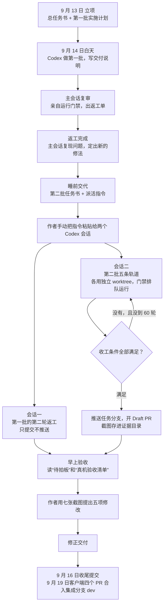

# 一个真实的夜晚

看不懂的词查[常用词解释](常用词解释.md)。

2026 年 9 月 14 日晚上，阿布要做“个人账号登录”这个功能。它横跨客户端仓库和运营后台，任务书和记录放在工作区目录。作者睡前把活交代给 Codex，Codex 通宵开发；作者早上起来验收。主会话（作者直接对话的那个 Agent，这一轮用的是 Claude Code）负责出任务书、复审和亲自运行门禁（把 lint、类型检查、全部测试串成一条命令，通过了才算做完）。

下面按时间顺序，写这一轮从立项到合入用到了 harness 的哪些部分。

## 1. 立项：先写清楚要什么

9 月 13 日，主会话写了一份总任务书。开头一节是“给执行者的规则”，后面依次是产品需求、现状（写明是当天实际读过代码的结果）、安全复审清单、批次划分与验收、开放问题。

第一批的实施计划里写着一句约束：只在指定分支工作，绝不推送到主分支。第二批任务书和修正任务书里也写了同类的约束。

对应制度：[方向](../01-方向/README.md)（需求任务书）、[边界](../03-边界/README.md)（分支推送边界）。

## 2. 白天第一批：做完要交“成果单”

Codex 做完第一批，交了一份交付说明：逐任务的提交表，并且写明“文档只在本地提交，没有推送”。实现用的是默认档模型（日常实现和复审用的那一档），安全相关部分另用旗舰档模型（最强、最贵的那一档）复审。

对应制度：[记录](../04-记录/README.md)（交付说明）、[方向](../01-方向/README.md)（按“做错了谁能发现”选模型）。

## 3. 主会话复审：不信自述，自己跑一遍

主会话没有直接接受交付说明。它复审了第一批，出了一份返工单，列出七条要修的问题（F1–F7）。返工单里每条问题都带着“已确认的证据”和代码位置，注明“动手前只需确认代码还在这个位置”，省掉执行方重复排查。

返工交付之后，主会话亲自运行了全量门禁（113 个测试文件、754 个用例），判定七条修复里六条修对、一条（F6）无效。无效的那一条，主会话自己复现了问题，定出新的修法和验证方法（F8），记进记忆，作为第二轮返工派给 Codex。

对应制度：[判定](../02-判定/README.md)（只认门禁退出码、独立复审）、[记录](../04-记录/README.md)（记忆）。

## 4. 睡前交代：把一整晚的事写成一份文件

第二批任务书标题写着“通宵并行版”，执行者 Codex 自主运行，作者次日早上验收。开头 7 条硬性规则：

1. 三个仓库分开操作；
2. 公开仓的保密红线；
3. 每个新 worktree（同一份代码的另一个独立工作目录，几个 Agent 各用一个，互不干扰）先初始化开发环境；
4. 门禁的输出写进日志文件，只认真实的退出码（命令结束时报告成功还是失败的一个数字，0 代表成功），不接管道（不把门禁的输出交给另一条命令处理，否则屏幕上显示的是后一条命令的成功）；
5. 门禁排队运行，不同时跑；
6. 遇到产品决策停下来，记进“待拍板”；
7. 不合并、不推送集成分支和发版分支、不开自动合并。

后面还写了：已经定下的设计（写明“不要重新发明”）、一晚上能验收什么、什么只能作者第二天手动验、交付说明必须有哪些小节，以及机器可以检查的收工条件：Draft PR（标成“草稿”的合并申请，只给人看，不会被合并）已开、三处门禁退出码为 0、工作区干净、截图数量够、两份调研文档存在。

派活指令的最后一句是 `or stop after 60 turns`：到 60 轮必须停，不许无限跑下去。

对应制度：[方向](../01-方向/README.md)（派活指令、`/goal` 上限）、[边界](../03-边界/README.md)、[判定](../02-判定/README.md)（机器可验的收工条件）。

## 5. 派活出了岔子

原计划由主会话操控电脑把指令发给 Codex。这一步被权限弹窗拒绝了，Codex 的命令行工具又缺文件，最后只能由作者手动粘贴，开了两个 Codex 会话。

夜间开发的起点仍然依赖人在场，这是阿布的 harness 到现在还没补上的一处缺口。

## 6. 夜里：两个会话并行

- **会话一**只做第一批的第二轮返工，最后提交了代码，没有推送任何分支。
- **会话二**做第二批的五条轨道（可以同时进行的几条独立工作）。每条轨道有自己的 worktree、分支和 Draft PR。安装、测试、构建由会话二自己排队分配，完整门禁也由它亲自运行。

会话二如实留下了失败记录：有一条轨道早期的门禁退出码是 0，但覆盖率（全部代码里被测试运行到的比例）低于阈值，所以不签收；另一条被外部的门禁重启打断；还有一条第一次全量 lint（自动检查代码写法的工具）失败。安全复审用的是旗舰档模型。

对应制度：[判定](../02-判定/README.md)（覆盖率不降）、[记录](../04-记录/README.md)（失败也要记）、[边界](../03-边界/README.md)（一个 worktree 只有一个负责人）。

## 7. 收工前自查

收工前，会话二逐一核对：每个 PR 都是 Draft、都没开自动合并；五个 worktree 都干净；截图 24 张齐全；证据摘要写进一个 JSON 文件。

对应制度：[判定](../02-判定/README.md)。

## 8. 早上验收

作者早上读交付说明里的“待拍板”和“真机验收清单”。清单共 7 步，从启动服务到检查浏览器地址参数，再到出故障时看哪个日志。点登录、跳到浏览器、再跳回桌面端，这一段完整往返只能由作者手动验证。

作者看完截图，用七张截图明确提出五项修改。主会话据此写了修正任务书，修正交付里写明“浏览器自动弹框仍待人工复验，不宣称该项已通过”。

对应制度：[判定](../02-判定/README.md)（真机验收、不夸大结果）、[记录](../04-记录/README.md)（真机验收清单）。

## 9. 收尾与延续

9 月 16 日，作者授权收尾提交，公开仓和私有仓各提交一次，没有推送、合并或发布。9 月 19 日，记忆更新为“客户端四个 PR 已合入集成分支 dev，随 v0.51.0 发布”，并新增一条规则：登录状态的管理程序只在公开仓保留一份，私有仓直接调用它，不再另写一份。

对应制度：[记录](../04-记录/README.md)（记忆写最终状态）、[进化](../05-进化/README.md)（从这一轮里长出新规则）。
