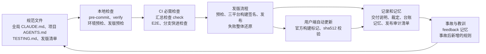

# harness 全景图

看不懂的词查[常用词解释](常用词解释.md)。

## 阿布的三个代码仓库

| 仓库 | 用途 | 公开吗 |
|---|---|---|
| 客户端仓库 [PM-Shawn/Abu-Cowork](https://github.com/PM-Shawn/Abu-Cowork) | 桌面应用“阿布”本体，开源版的全部功能都在这里 | 公开 |
| 企业版后台 | 给企业客户用的管理后台 | 不公开 |
| 企业闭源模块 | 客户端里企业版才有的功能，按 open-core 做法放在私有仓 | 不公开 |

另外有一个运营后台，服务开源客户端：收集匿名使用数据、处理用户反馈。全文说到“公开仓”指客户端仓库，“私有仓”指企业闭源模块，“企业版后台”和“运营后台”各指上面说的那一个。放任务书、记录和模板仓库的目录叫“工作区目录”。

## 五项制度

Agent 在无人看着的时候干活，常出的错可以归成五类。每一类用一项制度来管：

| 制度 | 管什么 | 防 Agent 的哪种毛病 |
|---|---|---|
| [方向](../01-方向/README.md) | 决定做什么、先做什么、按什么顺序和方法做 | 没弄清需求就动手，做出来的东西没人要；一上来就写代码，跳过设计 |
| [判定](../02-判定/README.md) | 判断一件事是否做完、是否做对 | 自己说“修好了”，其实没跑测试；测试全部通过，真实用起来却是坏的 |
| [边界](../03-边界/README.md) | 规定禁止做什么、允许在什么范围内做 | 为了让测试通过而删改别人的代码；把不该公开的东西推送到公开仓库 |
| [记录](../04-记录/README.md) | 留下以后能查的文字、台账、证据和提交信息 | 换一个会话就忘了之前的决定；第二天早上说不清夜里到底做了什么 |
| [进化](../05-进化/README.md) | 让规则和机制随事故、时间和新数据改进 | 同一个错犯第二次、第三次；规则越积越多，互相打架也没人发现 |

## 四个强度等级

同一条规则，执行的方式不同，效果差别很大。按“Agent 想违反时拦不拦得住”分成四级：

| 等级 | 含义 | 例子 |
|---|---|---|
| L0 口头 | 只在对话里说过，没有写进任何文件 | “以后别再这样了”，下一个会话就忘了 |
| L1 写进手册 | 写在 `AGENTS.md` / `CLAUDE.md` 等规范文件里，靠 Agent 自己读、自己遵守 | “每一行改动都要能追溯到用户的请求，追溯不到的删掉” |
| L2 有检查，但能绕过 | 有脚本、钩子、测试或 CI，但可以跳过、豁免，或者检查失败了仍能合并 | 提交前的 pre-commit 钩子，加 `--no-verify` 就能跳过 |
| L3 机器强制 | 违反了就过不去：代码无法编译，或者检查失败后 GitHub 不允许合并，或者自动流程在这一步停止 | PR 的必需检查没通过，GitHub 不让合并 |

写规则的时候，先问一句：**这条规则如果被违反，谁能发现？** 只能靠人发现的，尽量提升到 L2、L3；提升不了的，至少写进手册。

一条规则常常同时有几层：写在手册里是一层，本地脚本是一层，CI 是一层。模板仓库里遇到这种情况时按层分开写，例如“规范 L1；CI L3”。

作者在 2026-09-29 把阿布现有的全部规则和检查逐条清点了一遍（下文叫“盘点”），共 321 项，强度分布如下：

| 强度 | 数量 |
|---|---:|
| L0 口头 | 0 |
| L1 写进手册 | 156 |
| L2 有检查但能绕过 | 119 |
| L3 机器强制 | 45 |
| 不生效 | 1 |

“不生效”的那一项是旧桌面框架的冒烟 workflow：文件还在仓库里，但写了 `if: false`，永远不运行，只作为迁移前状态的证据保留。

一半左右的规则还停在 L1，靠 Agent 自觉。各制度目录末尾的“还没补上的缺口”一节，列的就是这些地方。每条规则对应的盘点编号见[盘点对照表](盘点对照表.md)，那张表是作者核对来源用的，读者可以不看。

## 各部分怎样连起来

规则写在规范文件里；本地检查和 CI 把其中一部分变成机器检查；发版流程和用户端更新是最后一道关；每一步都留下记录；出了事，教训写回规范文件，形成一个循环。

## 五项制度与开发阶段

第一次阅读可以跳过这张表，读完五个目录再回来看。横着看是开发的各个阶段，竖着看是五项制度。每格列出阿布里有代表性的做法，括号里是强度。

| 制度 | 需求分析 | 产品设计 | 开发实现 | 测试验收 | 发布上线 | 运营迭代 |
|---|---|---|---|---|---|---|
| 方向 | 先写用户故事，确认后再往下走（L1）；需求任务书（L1） | 界面用用户心里的说法（L1）；业务流程图（L1）；方案一次想完整（L1） | 修复前先说清根因（L1）；派活指令（L1） | PR 模板（模板 L2；逐项填写 L1） | 改版本号、写双语更新日志的步骤（L2）；部署手册（L2） | 北极星指标（L1） |
| 判定 | 实现前用户故事必须已确认（L1） | 用户确认点；独立复审设计（L1） | 测试确定性（lint L3；其余 L1）；提交前钩子（L2） | 汇总检查 `check`（L3）；E2E 必需检查（L3）；`verify` 退出码为 0（L2）；真机验收（L1） | 发版预检（CI L3；本地 L2）；三平台构建签名（L3） | 更新包校验（L3）；发版后核对（规范 L1；清单 L2） |
| 边界 | 暂无 | 遥测默认不采集、不传用户内容（L1） | 类型严格检查（L3）；禁止强制推送（L3）；不用 git 回滚（装了钩子的 Claude Code L2；其他工具 L1） | 泄露检查（CI L3；本地 L2）；覆盖率只升不降（规范 L1；阈值检查 L2） | 发版分支只接受快进（L3）；某些分支绝不推送到另一些分支（L1） | 更新器启用条件（L3） |
| 记录 | 竞品调研记录（L1） | 技术方案写成任务书（L1） | 提交信息规范（L2）；逐任务台账（L2） | 测试清单自动生成（CI L3；本地 L2）；交付说明（L2） | 双语更新日志（L3）；发布审计清单（L3） | 技术债记进 issue（L1） |
| 进化 | 暂无 | 暂无 | 设计规则自测（L2） | 不稳定测试隔离区与期限（客户端 CI L3；本地 L2） | 依赖漏洞允许清单（L2） | 依赖自动更新（L3）；双周对抗式审查（L1） |

最弱的地方在前两列：需求分析和产品设计几乎全是 L1。这两步最依赖人的判断，也最难交给机器检查，所以阿布的做法是在这里设“用户确认点”，确认之前 Agent 不许往下走。
