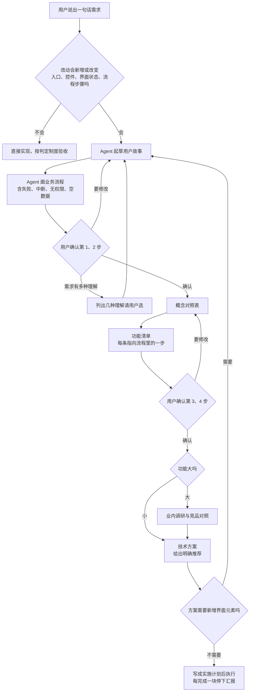
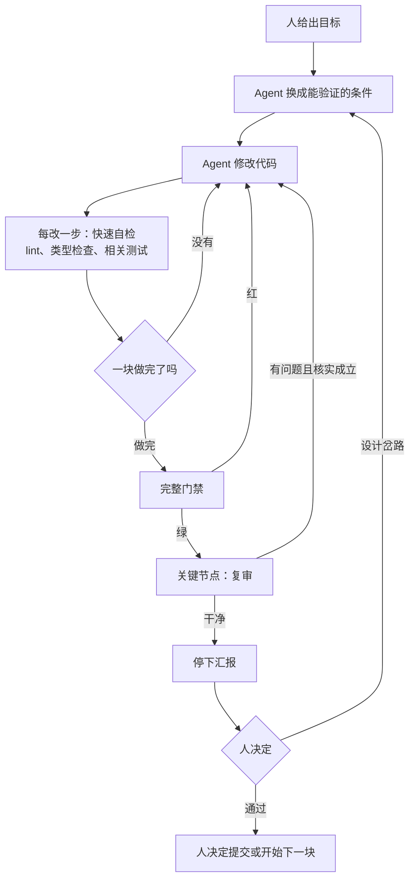

# 方向

看不懂的词查[常用词解释](../00-全景/常用词解释.md)。

Agent 拿到一句话需求，最常见的毛病是马上按自己的理解开写：从代码怎么实现出发去设计，悄悄在几种理解里挑一种，一口气跑到底。阿布里的真实例子：2026-08-25，Agent 写的第一版需求任务书按工程批次、文件行号和技术风险组织，作者读完的反馈是“看不出来功能逻辑”。“方向”这项制度规定做事的顺序：先弄清谁要用、要完成什么，再画流程、定界面用词，最后才出技术方案；派活时写清范围、禁令和上限。

## 规则一览

| 规则 | 强度 | 执行机制 | 适用范围 |
|---|---|---|---|
| [规范只有一份来源](#规范只有一份来源) | L1 | [mechanisms/CLAUDE.md](mechanisms/CLAUDE.md) | 通用 |
| [先走开发前置流程](#先走开发前置流程) | L1 | [templates/product-brief.md](templates/product-brief.md) | 通用 |
| [用户故事的写法](#用户故事的写法) | L1 | [templates/product-brief.md](templates/product-brief.md) 第 1 节 | 通用 |
| [业务流程画出异常分支](#业务流程画出异常分支) | L1 | [templates/product-brief.md](templates/product-brief.md) 第 2 节 | 通用 |
| [界面贴近用户心里的说法](#界面贴近用户心里的说法) | L1 | [templates/product-brief.md](templates/product-brief.md) 第 3 节 | 通用 |
| [需求任务书前四节固定](#需求任务书前四节固定) | L1 | [templates/product-brief.md](templates/product-brief.md) | 通用 |
| [动手前说清假设](#动手前说清假设) | L1 | 暂无，只靠 Agent 读规则 | 通用 |
| [竞品调研亲自去看](#竞品调研亲自去看) | L1 | [templates/product-brief.md](templates/product-brief.md) 第 5 节、[04-记录 的 reference-competitor.md](../04-记录/templates/reference-competitor.md) | 通用 |
| [修复前先讲清根因](#修复前先讲清根因) | L1 | [templates/pull_request_template.md](templates/pull_request_template.md) “修复类必填” | 通用 |
| [人和 Agent 的分工](#人和-agent-的分工) | L1 | [02-判定 的 goal-conditions.md](../02-判定/templates/goal-conditions.md) | 通用 |
| [夜间任务书写清收工条件](#夜间任务书写清收工条件) | L1 | [templates/overnight-brief.md](templates/overnight-brief.md) | 通用 |
| [派活指令写明上限和禁令](#派活指令写明上限和禁令) | L1 | [templates/dispatch-prompt.txt](templates/dispatch-prompt.txt) | 通用 |
| [按做错了谁能发现来选模型](#按做错了谁能发现来选模型) | L1 | 暂无，只靠 Agent 读规则 | 通用 |
| [节省 token 的做法](#节省-token-的做法) | L1 | 暂无，只靠 Agent 读规则 | 通用 |
| [先调推理强度再换模型（可选）](#先调推理强度再换模型可选) | L1 | 暂无，只靠 Agent 读规则 | 可选模块（Codex） |
| [按节点使用 superpowers 技能（可选）](#按节点使用-superpowers-技能可选) | L1 | superpowers 插件（每个会话自动注入，不检查是否调用） | 可选模块（superpowers 插件） |
| [先读框架随包文档（可选）](#先读框架随包文档可选) | L1 | 暂无，只靠 Agent 读规则 | 可选模块（框架版本比模型新） |
| [先读完用户给的链接](#先读完用户给的链接) | L1 | 暂无，只靠 Agent 读规则 | 通用 |
| [做完一块就停下汇报](#做完一块就停下汇报) | L1 | 暂无，只靠 Agent 读规则 | 通用 |
| [记下用户是谁](#记下用户是谁) | L1 | Claude Code 记忆（自动注入，内容不检查） | 通用 |
| [退役的入口改成报错指路](#退役的入口改成报错指路) | L2 | [mechanisms/retired-command.mjs](mechanisms/retired-command.mjs) | 来自阿布，已改写成通用版本 |
| [PR 按模板逐项填写](#pr-按模板逐项填写) | 模板 L2；逐项填写 L1 | [templates/pull_request_template.md](templates/pull_request_template.md) | 通用 |
| [发版步骤写成清单](#发版步骤写成清单) | 清单 L2；版本号与更新日志检查 L3 | [templates/release-checklist.md](templates/release-checklist.md) | 通用 |
| [部署手册写清唯一通道和回退办法（可选）](#部署手册写清唯一通道和回退办法可选) | L2 | [templates/deploy-runbook.md](templates/deploy-runbook.md) | 可选模块（自己部署服务端） |
| [作者的个人习惯（三条）](#作者的个人习惯可选) | L1 | 暂无，只靠 Agent 读规则 | 个人风格 |

## 规则详解

### 规范只有一份来源

**规则原文**

> 本目录的协作规范只写在 `AGENTS.md` 一份文件里，Claude Code 与 Codex 共同遵循。`CLAUDE.md` 只有一行 `@AGENTS.md`，把它整篇导入；只有 Claude Code 独有、Codex 没有的内容才写进 `CLAUDE.md`。改规范只改 `AGENTS.md`。子仓库各自的 `AGENTS.md` 仍然有效，针对该仓库的细节以子仓库文件为准。

- **防的是什么**：两个工具各读一份规范，改了一份忘了另一份，Agent 按不同文件得到相反的要求。
- **阿布里的来历**：规范里未写明来历。阿布的工作区目录、客户端仓库和企业版后台都用这种写法：`CLAUDE.md` 只有一行导入，正文全在 `AGENTS.md`。
- **强度**：L1。靠工具启动时自动读入文件；规范内容是否被遵守没有任何检查。
- **执行机制**：[mechanisms/CLAUDE.md](mechanisms/CLAUDE.md)。
- **怎样用到你的项目**：把现有规范合并进仓库根目录的 `AGENTS.md`，再把 `mechanisms/CLAUDE.md` 复制到它旁边。

### 先走开发前置流程

**规则原文**

> 新功能和非小型改动先走开发前置流程。改动不新增也不改变入口、控件、界面状态、流程步骤的（错别字、调间距、纯内部逻辑），免做第 1–4 步。
>
> 1. 用户故事（Agent 起草）
> 2. 业务流程（Agent 起草）
>    **第 1、2 步交用户确认后，才进入第 3 步。**
> 3. 概念对照表
> 4. 功能清单
>    **第 3、4 步交用户确认后，才进入技术方案。**
> 5. 业内调研与竞品对照（小功能可免）
> 6. 技术方案：讲清做法、关键权衡、风险，给出明确推荐。技术方案阶段不得新增界面元素，确实需要时回到第 1 步补用户故事。方案获得认可后写成实施计划再执行。
> 7. 能核实的事实实地去看，记忆和旧报告只作线索。
> 8. 大任务每完成一块停下汇报。

- **防的是什么**：Agent 从代码出发做设计，把只有读过代码才懂的概念放到界面上；或者没弄清用户要什么就写了一大堆代码，返工时代码全部作废。
- **阿布里的来历**：2026-09-18 作者提出产品设计要从用户视角出发，理由是纯从技术实现出发做设计，界面上会出现很多用户不需要、用起来不好用的东西；2026-09-19 写进工作区规范的“开发前置流程”“质量底线”“循环与自主开发约定”三节。措辞参考了 Alan Cooper《About Face》、Amazon Working Backwards、Jeff Patton 的 User Story Mapping 和 GitHub spec-kit。
- **强度**：L1。流程和两个确认点都只写在规范里，没有检查。
- **执行机制**：[templates/product-brief.md](templates/product-brief.md)。确认点、概念对照表、功能清单的检查方法见 [02-判定](../02-判定/README.md)。
- **怎样用到你的项目**：把规则原文复制进 `AGENTS.md`；“免做”的范围按你的项目改。

### 用户故事的写法

**规则原文**

> 用户故事由 Agent 根据用户的一句话需求起草，写清：谁、在什么情境下、想完成什么、做完的标志是什么。每个故事带优先级（P1 / P2 / P3），能单独演示。验收场景用 Given-When-Then 写，不写任何实现细节。需求有两种以上合理的理解时，把几种理解都摆出来让用户选。

- **防的是什么**：需求只停留在一句话，Agent 自己补全了用户没说的部分；验收时没有标准，只能凭感觉。
- **阿布里的来历**：规范里未写明来历。阿布的设计系统任务书（2026-09-28）按这个格式写了 9 条故事，例如“Given 已经有一个弹窗开着，When 另一个功能也要弹窗，Then 先关掉前一个再显示新的”。
- **强度**：L1。格式没有检查。
- **执行机制**：[templates/product-brief.md](templates/product-brief.md) 第 1 节。
- **怎样用到你的项目**：直接使用；优先级档位可以按团队习惯改名。

### 业务流程画出异常分支

**规则原文**

> 业务流程用 mermaid 画，包含异常分支：失败、中断、没有权限、没有数据。每一步写明用户看到什么、做什么。

- **防的是什么**：只画了一切顺利的那条路，失败时界面上显示什么、用户能做什么都没人想过，最后由 Agent 在代码里随手决定。
- **阿布里的来历**：规范里未写明来历。阿布的任务书里多数流程节点都写明用户看到什么，例如任务记录读取失败时“在对话区显示一句原因和重试按钮，其余界面正常”。
- **强度**：L1。没有检查。
- **执行机制**：[templates/product-brief.md](templates/product-brief.md) 第 2 节。
- **怎样用到你的项目**：直接使用。异常分支的清单可以按你的产品补充，例如“网络断开”“多人同时修改”。

### 界面贴近用户心里的说法

**规则原文**

> 界面设计以用户的 mental model（用户心里认为自己在做什么事）为准。implementation model（软件实际怎么运转）只出现在技术方案里。represented model（界面呈现出来的样子）必须贴近 mental model。界面上出现只有读过代码才能看懂的概念、状态、配置项，就判定为实现模型泄漏，要改掉。

- **防的是什么**：Agent 天天读代码，会把代码里的状态名、字段名和中间步骤原样搬到界面上，用户看不懂也用不顺。
- **阿布里的来历**：来自 2026-09-18 作者的同一次反馈，依据是 Alan Cooper《About Face》里“实现模型泄漏”的说法。具体做法是任务书第 3 节的概念对照表：第一列先写用户会说出口的话，第三列（界面上怎么呈现）只能用第一列的词。例如设计系统任务书里“设计变量、组件库、迁移名单”等概念第一列填不出来，就只在内部使用，不进界面。
- **强度**：L1。没有检查。
- **执行机制**：[templates/product-brief.md](templates/product-brief.md) 第 3 节。对照表的核对方法见 [02-判定](../02-判定/README.md)。
- **怎样用到你的项目**：直接使用。复审界面改动时，逐个核对界面上的词是否出现在对照表第一列。

### 需求任务书前四节固定

**规则原文**

> 按开发前置流程产出的需求任务书（文件名以 `-brief.md` 结尾）写成 `docs/【YYYY-MM-DD】-【功能名】-brief.md`，由 Agent 起草、用户确认。前四节固定为用户故事、业务流程、概念对照表、功能清单，之后才是业内调研和技术方案。技术方案讲清做法、关键权衡、风险，并给出明确推荐；技术方案阶段不新增界面元素，确实需要时回到用户故事一步补上。顶部留“待确认”一节：实现中确实需要功能清单之外的界面元素时记在这里，写明对应哪条用户故事、为什么需要，然后跳过这一项继续做。

- **防的是什么**：任务书一上来就写技术方案，用户要找的内容散在各处；方案只在对话里，会话结束就没了，执行 Agent 和复审 Agent 读不到同一份方案；复审的人和脚本也找不到固定位置去核对。
- **阿布里的来历**：规范里写了“前四节固定”，但盘点时（2026-09-29）发现两份任务书的前两节是“用户遇到的事”“业内怎么做”，用户故事排在第三节；只有设计系统任务书符合，它顶部还写着“第 1–6 节已确认（2026-09-28）”。
- **强度**：L1。格式没有检查，已经出现不符合的情况。
- **执行机制**：[templates/product-brief.md](templates/product-brief.md)。
- **怎样用到你的项目**：复制模板到 `docs/`，在 `AGENTS.md` 里写明任务书的位置和命名规则。

### 动手前说清假设

**规则原文**

> 适用于非小型任务（涉及多个文件、多个模块耦合、新功能、行为类 bug）。
>
> - 动手前用一句话说清你在假设什么。
> - 用户的请求有两种以上合理的理解时，列出来让用户选，不要默认挑一个就开始做。
> - 发现自己在猜，就停下来问。
> - 有更简单的方案，主动说出来。

- **防的是什么**：一个词在代码的几个地方各有含义，Agent 沉默地选了一种理解，做完才发现方向错了，返工比先问一句贵得多。
- **阿布里的来历**：客户端仓库规范的原话是，阿布的功能常常同时牵涉状态持久化、桌面壳、多语言、跨平台路径，一个词在三处可能各有定义，所以不要沉默选一个解释就开始做。
- **强度**：L1。没有检查。另外这条只写在客户端仓库，企业版后台和私有仓的 Agent 看不到（见文末缺口）。
- **执行机制**：暂无，只靠 Agent 读规则。
- **怎样用到你的项目**：把规则原文复制进每个仓库的 `AGENTS.md`，“非小型任务”的例子换成你项目里常见的耦合点。

### 竞品调研亲自去看

**规则原文**

> 业内调研和竞品对照必须亲自去看：打开本机安装的竞品实际操作，读安装包里的资源或开源代码，不凭记忆、不引用二手结论。每条结论写清出处（文件路径或操作步骤），截图存档。产出一张“竞品怎么做 → 我们怎么做”的对照表，写明哪些跟、哪些不跟以及理由。调研只为理解做法、作为设计输入，不照搬受版权保护的实现和文案。调研结论存成竞品调研记录（文件名以 `reference-` 开头），以后设计同类功能时先翻。小功能可以不做。

- **防的是什么**：Agent 凭训练数据里的印象描述竞品，结论过时或者根本是编的，设计建立在错误的前提上；设计时没有参照，做出与用户习惯不一致的界面。
- **阿布里的来历**：2026-09-14 的夜间批次里，竞品调研是一条单独的轨道，任务书要求“必须实际运行加阅读安装包资源，不许凭记忆或二手结论，每条结论标注来源文件路径或实际测试步骤”，六个问题每个都要截图，结尾给映射表。到 2026-09-29，工作区目录里已有 59 份竞品调研记录，记忆里另有 63 条参考记忆。
- **强度**：L1。没有检查。
- **执行机制**：[templates/product-brief.md](templates/product-brief.md) 第 5 节；记录的模板是 [04-记录 的 reference-competitor.md](../04-记录/templates/reference-competitor.md)，对应的记忆格式见 [04-记录 的 reference-example.md](../04-记录/templates/memory/reference-example.md)。“记忆只作线索、能核实的先核实”见 [02-判定](../02-判定/README.md)。
- **怎样用到你的项目**：在 `AGENTS.md` 里写明竞品调研记录存放的目录和命名（例如 `docs/reference-【主题】.md`）。

### 修复前先讲清根因

**规则原文**

> 非小型 bug 修复，动手改之前先说清根因，并回答：这是不是更深一层机制问题的一个表现？同一机制下还有没有同类问题？确属只处理表面的修复，要明确写出“这是临时止血，根因 X 待修”，并留下跟进项，不许悄悄只修表面。提出修复方案前先用 superpowers:systematic-debugging（先证伪再动手）。

- **防的是什么**：Agent 看到报错就照着类似问题的样子套一个修法，症状消失了，根因还在，同一机制的其他地方继续出错。
- **阿布里的来历**：规范里未写明来历。客户端仓库的 PR 模板“修复类必填”一栏要求写根因陈述、先失败后通过的证据，并确认“把修复撤掉后测试会变红（检查失败显示红色，通过显示绿色）”。
- **强度**：L1。PR 模板有这一栏，没有任何检查读取它。
- **执行机制**：[templates/pull_request_template.md](templates/pull_request_template.md) “修复类必填”。
- **怎样用到你的项目**：把规则原文复制进 `AGENTS.md`；没有 superpowers 插件时删掉最后一句，改成“先复现、再定位、再修复”。

### 人和 Agent 的分工

**规则原文**

> 判断“做完了没有”只认门禁命令的退出码，不认任何人或 Agent 的自述。
>
> - 人：给出能验证的目标；在设计岔路和检查点上做决定；决定提交和发版。不盯过程。
> - Agent：把目标换成能验证的条件，循环执行：每改一步运行快速自检，一块做完运行完整门禁，红了自己修；关键节点做复审；到检查点停下汇报。
> - 自主循环用 `/goal`，条件必须能度量、能验证，并且带轮数上限。

- **防的是什么**：人要么全程盯着每一步，要么完全放手；Agent 说“改好了”却没有证据。
- **阿布里的来历**：阿布的开发流程协议列出了几种真实出错的情形：退出码是假的绿（命令结尾接了一个总会成功的 echo，屏幕上显示的是 echo 的成功）、子代理报错了数字、长时间运行的子代理超时留下改了一半的文件，还有复审跑错了仓库。另一次（2026-09-14）是门禁后面接了 `| tail`，失败被显示成成功，见 [02-判定：门禁命令不接管道](../02-判定/README.md#门禁命令不接管道)。这些都靠主会话亲自运行门禁、看退出码发现。本目录模板里的 `echo "REAL_EXIT=$?"` 打印的是前一条命令自己的退出码，与上面那种写法不同。
- **强度**：L1。流程只写在文档里；门禁命令本身的强度见 [02-判定](../02-判定/README.md)。
- **执行机制**：`/goal` 目标的模板只有一份，放在 [02-判定 的 templates/goal-conditions.md](../02-判定/templates/goal-conditions.md)（七种场景，含“只起草设计”和“带界面的功能”）。`/goal` 条件的写法和验收规则见 [02-判定](../02-判定/README.md)。
- **怎样用到你的项目**：先准备一条“完整门禁”命令（lint、类型检查、全量测试、覆盖率串在一起，任何一步失败退出码不为 0），再把本节写进 `AGENTS.md`。

### 夜间任务书写清收工条件

**规则原文**

> 交给 Agent 整晚自主执行的任务书，必须包含：第 0 节硬性规则；需求原话；已定的设计决策（写明不要重新发明）；并行轨道及依赖关系；一晚上能做到什么、什么只能由人第二天手动验；交付说明的必需小节；机器可以检查的收工条件。遇到产品决策时停下记进“待拍板”，继续做不依赖它的任务。

- **防的是什么**：Agent 整晚没人管，缺少明确的终点就会一直做下去，或者半途自己替用户做产品决定；第二天人醒来，不知道做了什么、哪些要自己验。
- **阿布里的来历**：2026-09-14 个人账号批次：睡前写好“通宵并行版”任务书，五条轨道各用独立 worktree、独立分支和独立 Draft PR；第 0 节的硬性规则写明不合并、不推送集成分支和发版分支、不开自动合并；收工条件包括 Draft PR 已开、每处门禁退出码为 0、`git status --porcelain` 为空、至少 12 张截图、两份调研文档存在。第二天早上作者读“待拍板”和“真机验收清单”，看明暗两套截图，手动走了一遍浏览器跳回桌面端的流程，再用七张截图提出五项修改。
- **强度**：L1。任务书格式没有检查；收工条件由 Agent 自查。
- **执行机制**：[templates/overnight-brief.md](templates/overnight-brief.md)。交付说明的格式见 [04-记录](../04-记录/README.md)。
- **怎样用到你的项目**：复制模板，第 0 节换成你仓库的分支名和初始化命令。门禁用 `bash scripts/run-gate.sh verify` 运行，日志写在已被 `.gitignore` 忽略的 `.scratch/gate-logs/` 目录，重启后证据还在；脚本的安装见 [INSTALL.md](../INSTALL.md)。

### 派活指令写明上限和禁令

**规则原文**

> 派活指令是睡前粘贴给执行 Agent 的一段话，写明：先读哪些文件；最容易出错的几条硬性规则再重复一遍；轨道的开工顺序；遇到产品决策停下记录；不合并、不推送集成分支和发版分支；收工条件在哪里；用哪个模型和推理强度；最后一行写 `or stop after N turns`。派子代理时，硬性规则要写明“你再派的子代理也必须原样照抄”。

- **防的是什么**：指令里没有上限，Agent 会一直跑；禁令只写给直接派出的子代理，它再派出去的子代理看不到这些禁令。
- **阿布里的来历**：2026-09-14 睡前的派活指令给出要点 1–7、模型组合“涉及登录，不降档”、结尾 `or stop after 60 turns`。2026-09-25 一次调研中，主会话给调研子代理写了“禁止用 git 回滚”，子代理又派出一个孙代理，孙代理用 `git checkout -- .gitignore` 撤销了自己的修改；之后定下“禁令要写明再派的子代理也照抄”。
- **强度**：L1。没有检查。阿布当晚的派活还依赖作者手动粘贴，派活文本也没有进 git（见文末缺口）。
- **执行机制**：[templates/dispatch-prompt.txt](templates/dispatch-prompt.txt)。
- **怎样用到你的项目**：复制模板，换成你的路径和模型；把每晚的派活文本存进仓库，以后能查到当晚交代了什么。

### 按做错了谁能发现来选模型

**规则原文**

> 模型分四档：旗舰（最强最贵；没有机器验收、高风险的决策与终审）、默认（实现与复审）、机械批改（有门禁把关的批量机械改动）、只读检索（只回“结论 + 文件:行号”）。成本按“完成一个任务”计算，不按单次请求计算：便宜的模型多跑两轮、多返工一次就不便宜了。选模型只问一件事：这件事做错了，有没有能自动判断对错的检查能当场发现？
>
> | 情形 | 含义 | 选法 |
> |---|---|---|
> | 有能自动判断对错的检查 | 错了会被门禁退出码、单元测试、类型检查、契约测试当场发现 | 允许用便宜的模型（降档），错了由门禁拦下，重试成本低 |
> | 没有这样的检查 | 架构与接口决策、安全与权限、公开与私有代码的边界、数据迁移、发版与更新设计、CI 门禁与覆盖率机制本身、面向用户的文案 | 不降档，用最强的模型；这些错误只能靠人发现，返工代价远超模型差价 |

- **防的是什么**：按任务“看起来难不难”分配模型，便宜模型在没有检查把关的地方出错，错误一路流到用户或生产环境。
- **阿布里的来历**：2026-09-02 两个批次按旧的分档方法用便宜模型写代码，出现实现者卡在后台任务、复审反复要求补测试的来回。作者当场要求实现、复审和终审全程用同一个强模型，只把只读检索交给便宜模型，理由是动 CI 门禁、覆盖率和安全这类批次本身就是检查，上面没有更高一层的检查把关。2026-09-03 规范里“什么任务用哪个模型”的分配表按“做错了谁能发现”重写。价格示例：2026-09-08 阿布核价时，Claude 官方价格（每百万 token 输入 / 输出）为 Fable 5.1 $10/$50、Opus 5 $5/$25、Sonnet 5 $2/$10、Haiku 4.5 $1/$5；价格会变，使用前以官方价格页为准。
- **强度**：L1。没有检查；委派时是否显式指定模型也没有检查。
- **执行机制**：暂无，只靠 Agent 读规则。只读档不得做的决定见 [03-边界](../03-边界/README.md#模型分档与只读档的权限)；什么情况下升档见 [05-进化](../05-进化/README.md)；显式指定模型并记录实际组合见 [04-记录](../04-记录/README.md)。
- **怎样用到你的项目**：把规则原文复制进 `AGENTS.md`，“没有这样的检查”一行按你的项目补充；档位表里写你实际能用的模型名。

### 节省 token 的做法

token 指模型计算文字量和费用的单位。

**规则原文**

> - 检索交给便宜模型的子代理，只让它回“结论 + 文件:行号”，不回原文。主会话每一轮都要重新处理全部上下文，多读一个 2000 行的文件是持续的成本。
> - 互不依赖的任务在同一条消息里同时派出，减少等待的轮次。
> - 续跑时接着用已有的子代理（Claude Code 用 `SendMessage`），不新开一个再重新读一遍上下文。
> - 门禁只读退出码和失败的片段，不把全量日志读进上下文。
> - 同一批次内不换模型：缓存按模型分开，换模型等于缓存全部失效、重新读一遍上下文。
> - 长任务按批次用 `/clear` 清空上下文，不依赖自动压缩。

- **防的是什么**：上下文里堆满没用的原文和日志，费用上涨，Agent 的注意力也被稀释。
- **阿布里的来历**：规范里未写明来历。规范里的原话是，这些做法省下的量比换模型更大。
- **强度**：L1。没有检查。
- **执行机制**：暂无，只靠 Agent 读规则。
- **怎样用到你的项目**：直接复制。续跑子代理的具体命令按你用的工具改。

### 先调推理强度再换模型（可选）

适用于使用 Codex 这类可以调节推理强度（reasoning effort）的工具。

**规则原文**

> 要“再强一点”时，先提高推理强度，再考虑换更贵的模型：低强度的新模型常常比高强度的上一代强。会自行派发子任务的最高档，成本和耗时都无法预估，只在明确愿意为一个难题付费时使用。

- **防的是什么**：一遇到难题就换最贵的模型，或者直接开最高档，费用失控。
- **阿布里的来历**：规范里未写明来历。依据是 OpenAI 的建议：从有代表性的任务出发，按实际收益逐步提高推理强度。
- **强度**：L1。没有检查。
- **执行机制**：暂无，只靠 Agent 读规则。
- **怎样用到你的项目**：档位名称按你用的工具改。

### 按节点使用 superpowers 技能（可选）

适用于在 Claude Code 里启用了 superpowers 插件（一个第三方做的插件，里面是一组写好的工作方法，称为技能）的项目。

**规则原文**

> 只强制点名三个技能，其余按判断使用：
>
> - 第 1 步起草用户故事前、进入 plan mode 前，先运行 `superpowers:brainstorming`；
> - 技术方案获得认可后，用 `superpowers:writing-plans` 写成实施计划再执行；
> - 提出修复方案前，先运行 `superpowers:systematic-debugging`。
>
> Codex 没有这个插件，按同名技能的文字要求执行。

- **防的是什么**：插件每个会话都会注入，但哪些技能什么时候必须用没有写清，Agent 要么全都不用，要么每件小事都走一遍。
- **阿布里的来历**：规范里未写明来历。阿布只强制这三个，测试驱动开发等其他技能不作硬性要求，理由是它们与“分层测试 + 覆盖率只升不降”的质量底线重复。
- **强度**：L1。插件已启用并在每个会话注入入口技能，但没有检查是否真的调用了这三个。
- **执行机制**：superpowers 插件本身。
- **怎样用到你的项目**：没有这个插件就跳过本条；有的话把三个节点写进 `AGENTS.md`。

### 先读框架随包文档（可选）

适用于所用框架版本比模型训练数据更新的项目。

**规则原文**

> 这个版本的 【框架名】 有不兼容的改动，API、约定、文件结构都可能与你训练数据里的不同。写代码前先读 `node_modules/【框架包名】/dist/docs/` 里对应的指南，注意弃用提示。

- **防的是什么**：Agent 按记忆里的旧写法写新版本框架的代码，用到已被删除或改名的 API。
- **阿布里的来历**：阿布的企业版后台使用 Next.js 16，`AGENTS.md` 顶部有一段由 Next.js 自动维护的说明，要求写代码前先读 `node_modules/next/dist/docs/`，并标明这段不要手动修改。
- **强度**：L1。没有检查。
- **执行机制**：暂无，只靠 Agent 读规则。
- **怎样用到你的项目**：查一下你的框架包里是否带文档目录；有就把规则原文放在 `AGENTS.md` 最前面，换成对应的路径。

### 先读完用户给的链接

**规则原文**

> 用户提供网页链接时，先读完链接里的全部内容，再开始执行任务。发现库的用法错误时，重新读一遍用户提供的链接的全部内容，再改。

- **防的是什么**：Agent 只看了链接开头或者干脆没打开，就按记忆里的用法写代码；出错后继续凭记忆改，越改越远。
- **阿布里的来历**：规范里未写明来历。
- **强度**：L1。没有检查。
- **执行机制**：暂无，只靠 Agent 读规则。
- **怎样用到你的项目**：直接复制。

### 做完一块就停下汇报

**规则原文**

> 大任务每完成一块就停下汇报，或设一个检查点。宁可主动说出拿不准的地方、请求澄清，也不要盲目连续执行多轮。方案设计要一次给完整；执行过程按批次汇报进度。

- **防的是什么**：Agent 在错误的方向上连续执行很多轮，人发现时已经改了一大片。
- **阿布里的来历**：规范里未写明来历。阿布的夜间批次按轨道推进，每完成一条轨道就更新一次交付说明，人醒来可以看到每条轨道停在哪里。
- **强度**：L1。没有检查。
- **执行机制**：暂无，只靠 Agent 读规则。无人值守时的汇报方式见 [templates/overnight-brief.md](templates/overnight-brief.md) 第 5 节。
- **怎样用到你的项目**：直接复制；“一块”的大小可以在任务书里写明，例如“每条轨道”“每个任务”。

### 记下用户是谁

**规则原文**

> 第一次了解到用户的身份、背景、习惯时，记进记忆（Claude Code 的 user 类记忆）。之后给这位用户写文档、做汇报时，按对方的背景组织内容和用词。

- **防的是什么**：Agent 每次都用同一种工程师口吻写东西，读的人看不懂，或者关心的内容没写。
- **阿布里的来历**：作者是产品经理（2026-08-14 自述，记进了记忆）。2026-08-25 Agent 写的第一版需求任务书按工程批次、文件行号和技术风险组织，作者的反馈是“看不出来功能逻辑”；之后的需求任务书改为写用户从哪里进入、看到什么、每一步发生什么，以及异常时产品怎么表现，工程内容放进另一份配套文档。
- **强度**：L1。Claude Code 会把记忆自动放进上下文，内容对不对没有检查。
- **执行机制**：Claude Code 记忆。记忆的格式和索引见 [04-记录](../04-记录/README.md)。
- **怎样用到你的项目**：告诉 Agent 你的角色和你看文档时关心什么，让它记下来；Codex 等没有记忆功能的工具，把这些写进 `AGENTS.md`。

### 退役的入口改成报错指路

**规则原文**

> 已经退出开发和验收流程的入口（旧框架的启动、构建命令），不直接删除，改成打印“这条路已停用，请用某某命令”并以失败退出。

- **防的是什么**：Agent 从旧文档或记忆里找到旧命令，照着启动、构建，拿旧环境的结果当作新功能完成的证据。
- **阿布里的来历**：阿布的桌面壳从 Tauri 换成了 Electron，`src-tauri/` 只为已发布旧版本兼容、数据迁移和回退证据保留。`npm run tauri`、`tauri:dev`、`tauri:build` 等五个命令全部指向一个脚本，打印“Tauri 已退出功能开发与验收链路，请使用 Electron”并以退出码 1 结束。
- **强度**：L2。能拦住经 `npm run` 调用的入口；直接运行底层工具（例如 `npx tauri dev`）可以绕过。
- **执行机制**：[mechanisms/retired-command.mjs](mechanisms/retired-command.mjs)。
- **怎样用到你的项目**：复制脚本到 `scripts/`，改三个常量，再在 `package.json` 里把旧命令指向它。

### PR 按模板逐项填写

**规则原文**

> 开 PR（在 GitHub 上提出“请把我这条分支合并进去”的申请）时按模板逐项填写：改动类型、改了什么和为什么、测试层、门禁命令的输出与退出码、修复类的根因与先失败后通过的证据、真机验收走过的路径、安全复审链接。空着的项目等于没做完。AI 生成的 PR 同样必须逐项填。

- **防的是什么**：Agent 开的 PR 只写一句“修复了某问题”，审阅的人看不出测过什么、在哪里验过。
- **阿布里的来历**：客户端仓库的 PR 模板第一行写明“空项 = 未完成。AI 生成的 PR 同样必须逐项填”。企业版后台的 PR 模板另有三条声明（亲自运行门禁；检查过鉴权、权限、作用域、审计、密钥不回显；说明了迁移、兼容、回退），由一个 workflow 检查是否勾选，并要求一名非作者批准当前提交；但该仓库没有分支保护，检查失败也能合并。
- **强度**：模板 L2；逐项填写 L1。客户端的模板内容没有 workflow 检查，靠审阅的人看；“按模板逐项填写”这条规范只有“豁免理由”一项被改动行覆盖率脚本读取。企业版后台的三条声明有 workflow 检查，但不阻止合并。
- **执行机制**：[templates/pull_request_template.md](templates/pull_request_template.md)。
- **怎样用到你的项目**：复制到 `.github/pull_request_template.md`，改命令和测试层名称。想让它真的拦住合并，要写一个检查必填项的 workflow，并在分支保护里设为必需检查。

### 发版步骤写成清单

**规则原文**

> 发版的人工步骤写成一页清单，从上往下执行：在集成分支上把所有存放版本号的文件改成同一个值（包括锁文件）；两种语言的更新日志各写一份本版内容，不混写；发版前本地运行一组检查命令；从最终提交打候选 tag，全部平台构建通过后再打正式 tag。

- **防的是什么**：版本号漏改一处、更新日志写错语言，问题在发出去之后才被发现。
- **阿布里的来历**：阿布的版本号分布在五个文件里。客户端规范记录了一个具体的坑：改完 `package.json` 忘了同步 `package-lock.json` 的两个版本字段，当场不会报错，但之后任何人运行 `npm install` 都会被 npm 顺手改回来，把这两行无关改动带进别人的 PR。
- **强度**：清单 L2；版本号与更新日志检查 L3。写作要求只靠人和 Agent 自觉；版本号一致和更新日志语言由发版预检脚本在 CI 里强制检查（见 [02-判定](../02-判定/README.md)）。
- **执行机制**：[templates/release-checklist.md](templates/release-checklist.md)。
- **怎样用到你的项目**：把模板里的文件清单换成你项目里所有存放版本号的文件；能交给脚本检查的项目尽量交给脚本。

### 部署手册写清唯一通道和回退办法（可选）

适用于自己部署服务端的项目。

**规则原文**

> 服务端部署只走手册里写明的一条通道。手册写清：几条不能违反的规矩；唯一通道的每一步；部署前核实要部署的提交是线上版本的后代；每次部署记录提交号和镜像 Digest；部署后逐项核对；健康检查失败时怎么切回旧镜像；升级前备份，第一次交付前做一次恢复演练。

- **防的是什么**：Agent 或人各按记忆里的办法部署，部署的起点和线上实际运行的版本对不上，或者出了事才发现备份恢复不了。
- **阿布里的来历**：2026-08-25 运营后台部署时，没有核对线上实际运行的版本，一批从来没有上过线的提交跟着上去了，后台页面全部报 500，持续约一小时；之后部署脚本先读取线上镜像上的提交号，确认要部署的提交是它的后代。阿布还曾因在服务器上构建镜像导致整台机器不可用，所以手册规定只在 CI 构建镜像。企业版后台的部署文档写明：没有成功的恢复记录，已有的备份文件不能视为可以回退。
- **强度**：L2。部署脚本自带线上版本核实和冒烟检查（最简单的一次试运行，只确认服务能启动、主要功能能用），但整个流程靠人执行，脚本可以不用；健康检查失败时没有自动回退。
- **执行机制**：[templates/deploy-runbook.md](templates/deploy-runbook.md)。
- **怎样用到你的项目**：复制模板，把你实际验证过的那条部署路径逐步写进去，第一次交付前真的做一次恢复演练并记录。

## 阿布专属规则示例

| 规则 | 为什么阿布需要它 |
|---|---|
| 运营后台的北极星指标是“每周完成至少 1 次成功 AI 任务的用户”，不用只算打开次数的日活，核心事件固定 5 个 | 让埋点和运营功能围绕用户是否真正得到价值来做 |

## 还没补上的缺口

| 问题 | 后果 | 打算补的机制 |
|---|---|---|
| 开发前置流程、任务书格式、两个确认点都没有机器检查；“用户已确认第 1、2 步”没有固定的记录位置；已有任务书把用户故事排在第三节 | 任务书格式走样后没人发现，界面能否追溯到流程也无法复核 | 任务书模板顶部加确认记录（本目录模板已加）；写一个脚本检查任务书前四节的标题和顺序 |
| “动手前说清假设”“每行改动能追溯到需求”这些规则只写在一个子仓库里，其他仓库的规范引用了它们，却没有对应的正文 | 在其他仓库工作的 Agent 找不到这些规则 | 为每个仓库的 `AGENTS.md` 补上对应章节 |
| 本机检出的分支与规范所在的分支不一致，总规范里的“本机快照”已经过时 | Agent 按本机文件读到的是旧版或另一条线的规范 | 会话开始时运行脚本，检查检出分支与远程的差距；删掉过时的快照 |
| “什么任务用哪个模型”的分配表写的默认模型与工具实际配置的默认模型不一致 | Agent 按不同文件得到不同的模型选择 | 统一成一处，由作者决定后删掉另一处 |
| 工具可用性随会话变化：有的会话里 `/goal` 和 superpowers 技能不存在，只能改用“等价纪律”；派活要由人手动粘贴，派活文本也没有进 git | 夜间开发能否开始取决于人在不在场；工具不可用时的替代做法没有写进规范 | 在规范里写明工具不可用时的替代做法；派活文本存进仓库 |

## 作者的个人习惯（可选）

这三条是作者个人对 Agent 工作方式的要求，读者按自己的情况取舍。

**用户提到规范文件时重新读一遍**

> 每当我在消息里提到 `AGENTS.md` 或 `CLAUDE.md`，你必须重新阅读全局规范和当前项目的 `AGENTS.md`，不允许因为之前读过就不读。

**方案一次考虑完整**

> 设计任何方案都要一次考虑完整，不写“第一版先怎样，观察之后再怎样”；不把方案分成稳妥和激进两种。确实需要多个方案时，每个方案都必须能单独成立、互相平行。方案设计要完整给出，执行过程仍然按批次汇报进度。

**插问先答，答完继续原任务**

> 执行一件事的过程中，用户问了别的问题，能马上回答的就先回答，然后立刻继续原来的任务，不要做到一半就停下。

- **强度**：三条都是 L1，只靠 Agent 读规则。
- **阿布里的来历**：规范里未写明来历。
