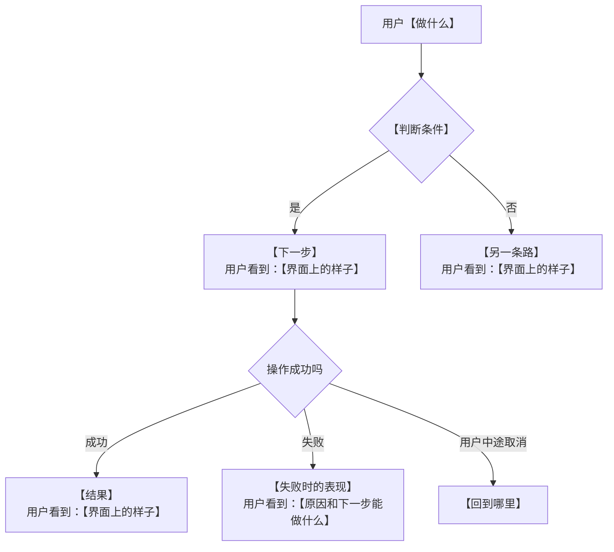

<!--
需求任务书模板。
用法：复制到 docs/【YYYY-MM-DD】-【功能名】-brief.md，由 Agent 起草，交给需求方确认。
要改的地方：
  1. 【……】包住的文字是占位，全部换成真实内容。
  2. 第 1–4 节的标题和顺序保持不变，这是为了让复审的人和脚本都能找到它们。
  3. 第 2 节和第 4 节末尾各有一行“用户确认”，填上日期和用户原话之后才往下做；没有填就停在这里。
  4. 小功能可以删掉第 5 节；不改入口、控件、界面状态、流程步骤的改动（错别字、间距、纯内部逻辑）不需要这份任务书。
-->

# 【功能名】· 任务书

> 实施计划：【技术方案确认后填链接】

## 待确认

<!-- 实现过程中发现需要功能清单之外的界面元素时，记在这里：对应哪条用户故事、为什么需要。记下后跳过这一项，继续做不依赖它的部分。没有就写“暂无”。 -->

（暂无）

## 1. 用户故事

<!--
每条故事写：谁、在什么情境下、想完成什么、做完的标志。
每条带优先级 P1 / P2 / P3，并且能单独演示。
验收场景用 Given-When-Then 写，只写用户看得到的东西，不写任何实现细节。
需求有两种以上合理的理解时，把几种理解都列出来，请需求方选。
-->

### P1-1 【一句话标题，用用户的话说】

我是【谁】，【在什么情境下】，希望【想完成什么】。

- Given 【前提】，When 【用户做了什么】，Then 【用户看到什么结果】。
- Given 【前提】，When 【用户做了什么】，Then 【用户看到什么结果】。

### P2-1 【标题】

【同上】

## 2. 业务流程

<!--
用 mermaid 画。必须包含异常分支：失败、中断、没有权限、没有数据。
每一步写明用户看到什么、做什么。
-->

### 流程一：【名称】

> 用户确认（第 1、2 节）：【YYYY-MM-DD，用户原话】

## 3. 概念对照表

<!--
每个会出现在界面上的概念占一行。
先填第一列，用用户会说出口的话来写。
第三列的用词只能来自第一列。
第一列填不出来的概念不进界面：给一个合理的默认值，收进内部，列在表格下面。
-->

第三列的用词只取自第一列。第一列填不出来的概念不进界面。

| 用户心里的说法 | 软件内部的叫法 | 界面上怎么呈现 |
|---|---|---|
| 【用户会说的话】 | 【代码里的名字、字段、状态值】 | 【界面上的控件和文案】 |

以下概念第一列填不出来，只在内部使用，不进界面：【概念 1】、【概念 2】。

## 4. 功能清单

<!-- 每一条都要指向第 2 节流程里的某一步。界面上的入口、控件、状态、文案，指不到流程的从界面上去掉。 -->

每一条都指向第 2 节流程里的某一步，以及第 1 节的用户故事。

| 编号 | 功能 | 对应流程步骤 | 对应用户故事 |
|---|---|---|---|
| F1 | 【功能描述】 | 流程一【节点编号】 | P1-1 |

范围边界：

- 【这次明确不做的事】

> 用户确认（第 3、4 节）：【YYYY-MM-DD，用户原话】

## 5. 业内调研与竞品对照

<!-- 亲自打开竞品实际使用、阅读安装包或源码，不凭记忆。每条结论写清出处（文件路径或操作步骤）。只为理解做法，不照搬受版权保护的实现和文案。 -->

| 问题 | 竞品怎么做（出处） | 我们怎么做 |
|---|---|---|
| 【问题】 | 【做法】（【出处】） | 【我们的选择和理由】 |

## 6. 技术方案

<!-- 讲清做法、关键权衡、风险，给出明确推荐。技术方案阶段不新增界面元素；确实需要时，回到第 1 节补用户故事。 -->

### 6.1 做法

### 6.2 权衡与推荐

### 6.3 风险

### 6.4 测试

<!-- 每条 P1 用户故事的 Given-When-Then 对应哪个 E2E 测试文件。 -->
